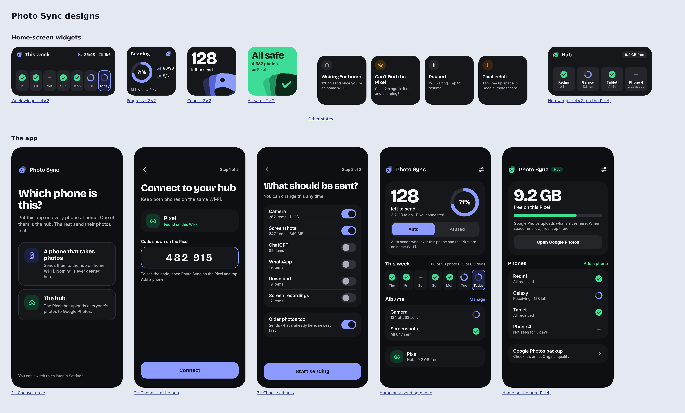

# gp-sharing

Sends photos from several Android phones to one Google Pixel over home Wi-Fi, so that only
the Pixel uploads them to Google Photos. A first-generation Pixel gets unlimited
Original-quality storage; the other phones keep their own copies and never delete anything
automatically.

```
Phone A ─┐
Phone B ─┤  Syncthing (home Wi-Fi only)     Pixel (receives)              Google Photos
Tablet C ┼────────────────────────────▶  DCIM/Sync/<device>-<folder>/ ──▶ (unlimited)
Phone D ─┘
```

## Versions

| Version | Where | What it is |
|---|---|---|
| **v1 (stable)** | branch `stable/v1`, tag `v1.0.0`, and the v1.0.0 release | Syncthing-Fork does the transfer. A setup script prepares each phone over USB, and a small "Photo Sync" app adds a status widget and an on/off switch. |
| Next | branch `main` | Work towards one standalone app. Planned, not started; see below. |

## Use v1

You need a PC with `adb`, and USB debugging turned on for each phone.

```bash
./setup-device.sh --role pixel      # once, with the Pixel plugged in
./setup-device.sh --role source     # once per other phone
```

The script installs Syncthing-Fork and the Photo Sync app, then prints the few steps that
have to be done by hand on the phone. [SETUP.md](SETUP.md) is the full guide.

The Photo Sync app is attached to each GitHub release as `photosync-widget.apk`. To build
it yourself, run `widget/build.sh` (plain Android SDK tools, no Gradle; the first run
downloads the SDK).

## What's next

The plan is to replace the Syncthing setup with one app that needs no PC, no API key and
no second app, with a new set of home-screen widgets.

- [PLAN.md](PLAN.md): the Android redesign, its phases and the open decisions.
- [PLAN-IOS.md](PLAN-IOS.md): how an iPhone or iPad could send to the same hub.
- [design/](design/): mockups of the widgets and app screens. Open `design/index.html`
  in a browser.



## Signing key

`widget/build.sh` creates `widget/photosync.keystore` on its first run. The file is not in
this repository. Keep a private copy: Android only installs an update over the existing
app when it is signed with the same key. A build from a fresh clone gets a new key, so it
installs only after the old app is removed.
